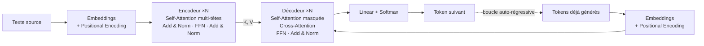
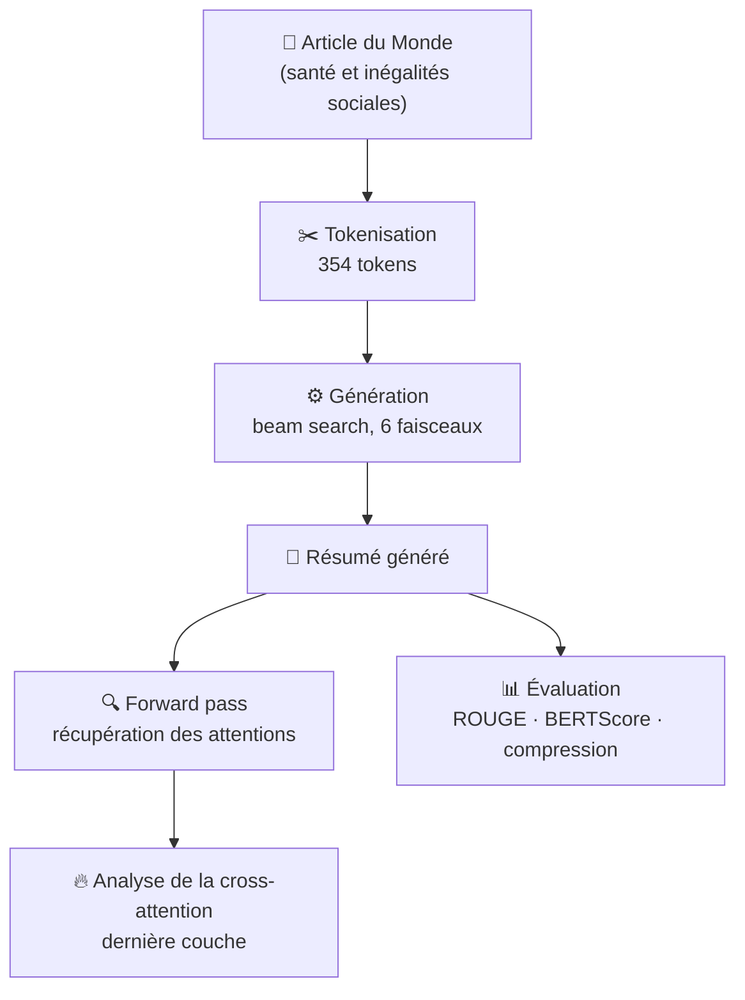

<div align="center">

# 🤖 Comprendre les Transformers

**De la théorie de *« Attention Is All You Need »* à un résumé automatique de texte en français**

[](https://www.python.org/)
[](https://pytorch.org/)
[](https://huggingface.co/docs/transformers)
[](https://colab.research.google.com/github/filou337/Transformers-/blob/main/Transformers.ipynb)

*Emmanuel THE · Philippe Roumbo · Décembre 2025*

</div>

---

## 📖 Sommaire

- [À propos](#-à-propos)
- [Contenu du dépôt](#-contenu-du-dépôt)
- [Partie 1 : la théorie](#-partie-1--la-théorie)
- [Partie 2 : la pratique (résumé de texte)](#️-partie-2--la-pratique-résumé-de-texte)
- [Résultats](#-résultats)
- [Lancer le projet](#-lancer-le-projet)
- [Références](#-références)

---

## 💡 À propos

Ce projet a deux objectifs :

1. **Expliquer** le fonctionnement interne d'un Transformer : embeddings, encodage positionnel, self-attention, multi-head attention, Add & Norm, feed-forward, décodeur masqué, projection finale et softmax.
2. **Mettre la théorie en pratique** avec un modèle encodeur-décodeur pré-entraîné (**BARThez**) qui résume un article de presse français. On y observe ce que le modèle « regarde » (cross-attention) et on évalue le résumé obtenu avec **ROUGE**, **BERTScore** et le **taux de compression**.

---

## 📂 Contenu du dépôt

| Fichier | Description |
|---|---|
| [`Transformers_Presentation.pdf`](Transformers_Presentation.pdf) | Présentation de 22 slides sur l'architecture du Transformer, avec les formules |
| [`Transformers.ipynb`](Transformers.ipynb) | Notebook : résumé automatique, analyse de la cross-attention et évaluation |

---

## 🧠 Partie 1 : la théorie

### Pourquoi les Transformers ?

Les RNN, LSTM et GRU traitent les séquences **mot par mot**. Ils ont deux limites :

- ⏳ **un traitement séquentiel**, donc un entraînement lent et difficile à paralléliser ;
- 🔗 **du mal avec les phrases longues** et les dépendances à longue distance.

L'article *Attention Is All You Need* (Vaswani et al., 2017) **supprime la récursivité** et repose entièrement sur le **mécanisme d'attention**, calculé en parallèle.

### L'architecture



### Les formules clés

**Encodage positionnel** : il injecte l'ordre des mots dans les embeddings.

$$PE_{(pos,2i)} = \sin\left(\frac{pos}{10000^{2i/d_{model}}}\right) \qquad PE_{(pos,2i+1)} = \cos\left(\frac{pos}{10000^{2i/d_{model}}}\right)$$

**Scaled dot-product attention** : chaque token pondère l'importance de tous les autres.

$$\text{Attention}(Q, K, V) = \text{softmax}\left(\frac{QK^T}{\sqrt{d_k}}\right)V$$

- **Q** (*Query*) : ce que le mot cherche
- **K** (*Key*) : comment le mot peut être trouvé
- **V** (*Value*) : l'information qu'il apporte

**Multi-head attention** : la phrase est lue sous *h* « angles de vue » en parallèle.

$$\text{MultiHead}(Q,K,V) = \text{Concat}(\text{head}_1, \dots, \text{head}_h)W^O$$

**Add & Norm** et **Feed-Forward** :

$$\text{LayerNorm}(x + \text{Sublayer}(x)) \qquad \text{FFN}(x) = \max(0,\ xW_1 + b_1)W_2 + b_2$$

**Self-attention masquée (décodeur)** : le modèle ne peut pas « tricher » en regardant les mots futurs.

$$\text{softmax}\left(\frac{QK^T + M}{\sqrt{d_k}}\right)V, \qquad M_{t,k} = \begin{cases} 0 & \text{si } k \le t \\ -\infty & \text{si } k > t \end{cases}$$

> 📑 Le détail, avec les schémas, se trouve dans la [présentation PDF](Transformers_Presentation.pdf).

---

## 🛠️ Partie 2 : la pratique (résumé de texte)

### Le modèle : BARThez

[`moussaKam/barthez-orangesum-abstract`](https://huggingface.co/moussaKam/barthez-orangesum-abstract) est un modèle encodeur-décodeur de type **BART**, pré-entraîné en français et affiné sur **OrangeSum**, un jeu de données d'articles d'actualité accompagnés de leurs résumés.

### Le pipeline



1. **Tokenisation** : le texte source (un extrait d'un article du *Monde* sur le baromètre 2024 de Santé publique France) est découpé en 354 sous-mots.
2. **Génération** : décodage auto-régressif en *beam search* (`num_beams=6`, `no_repeat_ngram_size=3`, `repetition_penalty=1.10`, 35 à 120 nouveaux tokens).
3. **Extraction des attentions** : le résumé est repassé dans le modèle pour récupérer les attentions de l'encodeur et la cross-attention (6 couches chacune).
4. **Analyse** : on repère les paires *token du résumé → token source* dont le poids d'attention dépasse 0,3.
5. **Évaluation** du résumé avec trois métriques complémentaires.

### Le résumé obtenu

> *« Si les Français sont plus de deux sur trois à déclarer une bonne » ou une « très bonne » santé générale, le ratio atteint 82,5 % parmi les individus à l'aise financièrement, contre 50,4 % pour ceux qui déclarent une situation financière difficile. »*

---

## 📊 Résultats

### ROUGE (référence : texte source)

| Métrique | Précision | Rappel | F1 |
|---|:---:|:---:|:---:|
| ROUGE-1 | 0,979 | 0,157 | 0,270 |
| ROUGE-2 | 0,915 | 0,144 | 0,249 |
| ROUGE-L | 0,958 | 0,153 | 0,264 |

➡️ **Précision très élevée** : presque tous les mots du résumé viennent du texte. **Rappel faible**, ce qui est normal pour un résumé court qui ne couvre qu'une partie de la source.

### BERTScore (référence : résumé humain)

| Précision | Rappel | F1 |
|:---:|:---:|:---:|
| 0,750 | 0,678 | **0,712** |

➡️ Le résumé est **sémantiquement proche** du résumé humain, mais il ne reprend pas toutes ses informations.

### Taux de compression

| Texte source | Résumé | Taux |
|:---:|:---:|:---:|
| 1 653 caractères | 247 caractères | **≈ 15 %** |

---

## 🚀 Lancer le projet

**Option 1 : Google Colab (le plus simple)**

Clique sur le badge [](https://colab.research.google.com/github/filou337/Transformers-/blob/main/Transformers.ipynb) puis exécute les cellules dans l'ordre. Un GPU est conseillé mais pas obligatoire.

**Option 2 : en local**

```bash
git clone https://github.com/filou337/Transformers-.git
cd Transformers-
pip install torch transformers sentencepiece rouge_score bert_score matplotlib pandas jupyter
jupyter notebook Transformers.ipynb
```

---

## 📚 Références

- Vaswani et al., 2017 : [*Attention Is All You Need*](https://arxiv.org/abs/1706.03762)
- Kamal Eddine et al., 2021 : [*BARThez: a Skilled Pretrained French Sequence-to-Sequence Model*](https://arxiv.org/abs/2010.12321)
- Lin, 2004 : [*ROUGE: A Package for Automatic Evaluation of Summaries*](https://aclanthology.org/W04-1013/)
- Zhang et al., 2020 : [*BERTScore: Evaluating Text Generation with BERT*](https://arxiv.org/abs/1904.09675)
- [Documentation Hugging Face Transformers](https://huggingface.co/docs/transformers)

---

<div align="center">

⭐ *Si ce projet t'a aidé à comprendre les Transformers, n'hésite pas à laisser une étoile !*

</div>
